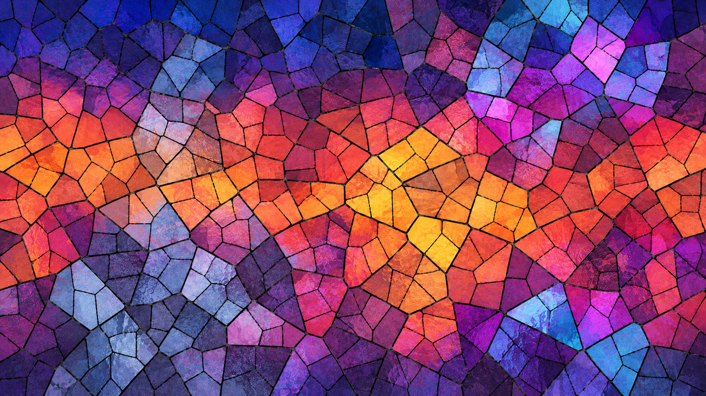

# Cyberpunk renderer

For fun, quickly trying effects and seeing what sticks. Roughly follows [the contest](https://orrc.mutantstargoat.com/):
each round adds one more render and some new effects.

# Screenshots

## 01: Cyberpunk

To be revealed after the round.

## Why and how

Keep it simple. Generators put things in an image buffer; combiners mix, distort
and process them. Each render picks the pieces and puts them together. Easy to
add an effect, change the order or throw something away.
